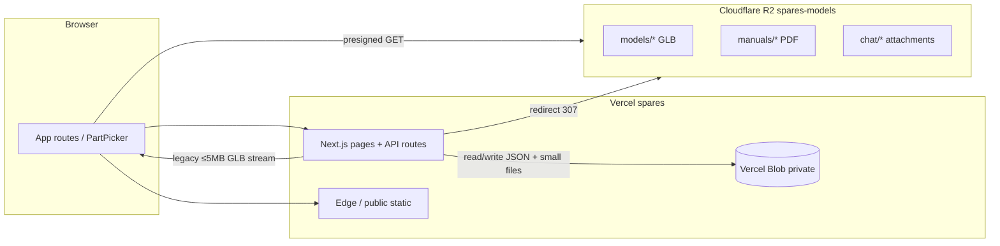

# Spares / OEE360 — spend ↔ site-map audit

**Prepared:** 2026-09-26  
**Scope:** Investigation only (no product behavior changes).  
**Team / billing:** Yonder Pro (`yonder3`), Vercel project **`spares`** (production alias **https://oee360.com**). Yonder app paused — costs below are Spares/OEE360.

**Sources**

| Source | Location |
| --- | --- |
| Live Usage line items + daily totals (billing cycle Sep 6 3:00 – Oct 6 3:00) | Team Usage UI; tabulated in repo upload `uploads/vercel-ondemand-audit-inputs.md` (agent copy) |
| Route / storage behavior | This repo (`src/app/**`, `src/lib/**`, `README.md`, `docs/soft-launch-backup.md`) |
| Historical project split | Inputs note: ~100% of Fast Origin Transfer attributed to **`spares`** through ~Sep 16 |

**Cycle totals (measured)**

| Metric | Value |
| --- | --- |
| On-demand charges (after $20 included credit) | **$134.64** |
| Infrastructure subtotal (before credit) | **$154.63** |
| Pro subscription (excluded from on-demand table) | ~$20 |

---

## Executive summary

| Period | ~$ | What happened |
| --- | --- | --- |
| **Sep 6–7** | **~$124.47** (~**80%** of infrastructure subtotal) | **Fast Origin Transfer** spike: large **GLB/model bytes** left Vercel Functions/origin (historical Blob + `/api/machines/:id/file` proxy), not CDN `public/` assets. |
| **Sep 8 – mid-Sep** | **~$1–6/day** | Residual origin transfer + **Blob** reads/writes + **Observability** + **Fluid** CPU from app/API usage (quotes, care, staff, uploads, chat long-poll). |
| **Late Sep (e.g. Sep 24–26)** | **~$0.02/day** | Trickle: low traffic; R2-signed model URLs and proxy caps largely doing their job. |

**Verified in repo:** After `S3_*` (R2) is configured, `GET /api/machines/:id` returns a **presigned R2 GET** in `fileUrl`; `/api/machines/:id/file` **redirects** to R2 when the object exists, otherwise streams **only ≤ 5 MB** legacy Blob/fs models (`MODEL_PROXY_MAX_BYTES` in `src/lib/pack-limits.ts`, `resolveMachineFileServe` in `src/lib/model-file-serve.ts`). Public marketing assets under `public/` are **&lt; 1 MB** total for GLBs/video — not a TB-scale driver.

---

## Storage & traffic architecture (what can bill what)

| Store | Paths / keys | Typical content | Vercel line items |
| --- | --- | --- | --- |
| **Cloudflare R2** (`S3_*`, bucket e.g. `spares-models`) | `models/`, `manuals/`, `chat/` | GLBs, manual PDFs, chat media | **None** for browser↔R2 bytes (off-Vercel). Function may still **HEAD/exists** and **mint presigned URLs** → Fluid CPU + invocations. |
| **Vercel Blob** (`BLOB_READ_WRITE_TOKEN`) | `spares/db.json`, `care.json`, `activity.json`, `spares/files/*` | Catalog JSON, care sidecar, PO PDFs, screenshots, **legacy small GLBs** | **Blob Data Transfer**, **Blob Simple/Advanced Operations**, occasional **Fast Origin** if streamed through API |
| **`public/`** (Vercel static) | `landing/`, `placeholders/`, `export/` | Landing MP4 (~647 KB), demo GLBs (&lt; 300 KB each), macro docs | **Fast Data Transfer** (mostly free tier this cycle: 135 GB / 1 TB) |
| **Functions origin** | Responses from `route.ts` handlers | Proxied binaries, multipart pack ingest, JSON from Blob via function | **Fast Origin Transfer**, **Fluid CPU/Memory** |

Blob layout is documented in `src/lib/blob-paths.ts` and `docs/soft-launch-backup.md`.

---

## Site map → likely $ drivers

**Share of cycle** uses infrastructure subtotal **$154.63** unless noted. **Measured** = from Usage UI; **estimate** = inferred from code + daily shape.

### Customer-facing surfaces

| Site surface | Route(s) | Primary backends | Likely $ line item(s) | ~Share of cycle | Notes |
| --- | --- | --- | --- | --- | --- |
| Marketing / sign-in gate | `/`, `/login`, `/inquire` | SSR + `GET /api/auth/*` | Fluid CPU, Blob ops (catalog read) | **&lt;1%** (estimate) | `force-dynamic` on `/` and login. Tiny static video on landing. |
| Machine list & detail **3D viewer** | `/machines`, `/machines/[id]` | `GET /api/machines/:id` → `machineFileUrl`; PartPicker loads `fileUrl` | **Sep 6–7:** Fast Origin (**measured**, dominant). **Now:** R2 egress (off bill) + small Fluid | **Spike: ~80%**; **steady: trace** | **Main historical burn.** Viewer README: use `fileUrl`, not blob URL prefetch (`src/components/viewer/README.md`). |
| Model fallback proxy | `GET /api/machines/:id/file` | `resolveMachineFileServe` → R2 redirect or Blob stream | Fast Origin (if stream), Blob DT | **Spike: high**; **steady: low** if R2 hit | Capped at **5 MB** on Vercel when not in R2 (`vercelLargeModelProxyMessage`). |
| Request quote from machine | `/machines/[id]/quotes`, `POST /api/quotes` | Store write → Blob `put` db/care | Blob ops + Fluid | **&lt;1%** steady | |
| Quotes workspace | `/quotes`, `/quotes/[id]` | Quote APIs, activity, attachments, assistant | Blob + Fluid + (R2 for attachments) | **~2–5%** steady (estimate) | Chat uses `GET /api/chat/watch` (long poll, `maxDuration = 30`). |
| Quote attachments | `/api/quotes/:id/attachments/*` | R2 presigned PUT/GET when `S3_*` set; else proxy POST to Blob | Blob DT/ops if proxy; else R2 only | Part of quotes row | `assertChatAttachmentUploadAllowed` requires R2 on Vercel. |
| PO PDF | `GET/POST /api/quotes/:id/po` | `readStoredFile` from Blob | Blob DT | **&lt;1%** | Small PDFs. |
| Machine Care (customer) | `/care`, `/care/tickets/*` | Care APIs, tickets, manuals | Blob + Fluid + R2 manuals | **~2–4%** steady (estimate) | Manuals: redirect to R2 when configured (`manuals/.../file/route.ts`). |
| Access inquiry | `POST /api/inquiries` | Store | Blob ops | **&lt;1%** | |

### Staff surfaces

| Site surface | Route(s) | Primary backends | Likely $ line item(s) | ~Share of cycle | Notes |
| --- | --- | --- | --- | --- | --- |
| Staff home / nav | `/staff/*` (quotes, tickets, customers, team, bugs, activity) | Most routes hit store → **Blob JSON read every invocation** (no in-process cache on Vercel: `trustProcessMemory()` only for local fs) | **Blob simple ops + DT**, Fluid CPU | **~5–10%** mid-Sep (estimate) | Explains **3.56M** Blob simple ops over the month. |
| Upload pack / replace model | Staff machine flows, `POST /api/machines`, `POST .../pack`, `POST /api/machines/model-upload` | Presigned R2 PUT or Blob client upload; serverside **GLB compress** (`maxDuration` 120) | **Sep 6–7:** Origin + Fluid during migration; **now:** Fluid on ingest, R2 write | Spike if multipart/Blob path used | Without `S3_*`, Vercel Blob client upload capped at **5 MB** (`blobUploadMaxBytes`). |
| Backfill legacy models | `POST /api/staff/machines/backfill-models` | Reads Blob `spares/files/*`, writes R2 | Fast Origin + Blob DT + Fluid | Spike-day activity (estimate) | One-shot; skips &gt; 40 MB (`MODEL_BACKFILL_MAX_BYTES`). |
| SolidWorks add-in publish | Same APIs as upload | Same as pack | Same as upload | Usage-dependent | Documented in `solidworks-addin/README.md`. |
| Platform / Hosts / Directory | `/staff/platform/*`, `/api/platform/*` | Tenant admin, deployments metadata | Fluid + Blob | **&lt;2%** | Multi-tenant; not Yonder. |
| Dev viewer (non-prod path) | `/dev/viewer` | Local/public placeholder GLBs | Fast Data Transfer / Origin | **Negligible** on prod | Uses small `public/placeholders/*`. |

### APIs that amplify cost (not a separate “page”)

| API | File | Cost mechanism |
| --- | --- | --- |
| **Catalog read on almost every authenticated call** | `readDatabase()` → `getPersistence().readDatabaseJson()` in `src/lib/store.ts` | **Blob GET** per serverless instance (`useCache: false` on blob reads in `persistence.ts`) |
| **Chat long-poll** | `GET /api/chat/watch` | Holds function up to **25s** (`CHAT_WATCH_HOLD_MS`), peeks Blob every **1s** for watch files |
| **Pack / create machine** | `POST /api/machines`, `.../pack` | **120s** max duration, CPU for meshopt/Draco compress |
| **Assistant** | `.../assistant`, `scheduleAssistantReply` from activity routes | Fluid CPU + external LLM (provider $ not in this Vercel bill) |
| **Attachment proxy** (legacy / dev) | `.../attachments/proxy` | Bytes through origin → Fast Origin + Blob |

---

## Line-item deep dive (measured totals → repo mapping)

| Vercel line item | Measured | ~% of $154.63 | Mapped site / code surfaces |
| --- | --- | --- | --- |
| **Fast Origin Transfer** | 2 TB, **$124.07** | **80%** | **`GET /api/machines/:id/file`** streaming GLBs from Blob; **pack upload** paths that sent large bodies through the function; **backfill**; any pre-R2 **Blob `spares/files/*.glb`** downloads. **Not** `public/placeholders` (too small). Confirmed project **`spares`**. |
| **Blob Data Transfer** | 156 GB, **$7.80** | **5%** | Repeated **`db.json` / `care.json` / `activity.json`** reads; **`spares/files/*`** (PO PDFs, screenshots, legacy GLBs); chat watch JSON in Blob; client↔Blob for uploads when R2 absent. |
| **Observability Events** | 6.05M, **$7.26** | **5%** | **No SDK in repo** — billing is from **Vercel Observability** (dashboard/logs/traces). Correlates with **mid-Sep daily $2–6** when team was actively testing Soft Launch. |
| **Fluid Active CPU** | 51 h, **$6.62** | **4%** | JSON parse/heal, quote/care CRUD, **GLB compress** on upload, **chat watch** holds, assistant scheduling, auth/session. |
| **Build CPU Minutes** | 19 h, **$3.95** | **3%** | Preview + production builds (config in repo does not limit deploy count). Steady cost, not Sep 6–7 spike. |
| **Fluid Provisioned Memory** | 195 GB·h, **$2.07** | **1%** | Same routes as Fluid CPU (long-running pack/chat). |
| **Blob Simple Operations** | 3.56M, **$1.43** | **1%** | High **GET/PUT count** on JSON + small files (serverless **no memory cache** on Vercel). |
| **Function Invocations** | 798.67K, **$0.48** | **&lt;1%** | All `/api/*` routes (~70 handlers under `src/app/api`). |
| **Edge / ISR / Fast Data Transfer** | within free tier | **0%** this cycle | `public/` + edge requests 3.99M / 10M. |

---

## Sep 6–7 spike vs steady state

| | Sep 6–7 | Sep 8 – Oct 6 (remainder) |
| --- | --- | --- |
| **Daily $ (on-demand table)** | **$27.95 + $96.52 ≈ $124.47** | **~$10.17** over ~19 days (~**$0.50/day** avg; late month **~$0.02/day**) |
| **Dominant line item** | Fast Origin (blue bars in Usage chart) | Mix: Blob + Observability + Fluid |
| **Product story (consistent with repo)** | Large **GLB** traffic still on **Vercel origin** (Blob storage + `/file` proxy) during Soft Launch / migration | **R2 signed URLs** for models (`machineFileUrl`), **5 MB proxy cap**, chat attachments **require R2 on Vercel** — origin transfer largely stopped |
| **Ops checklist** | Wire `S3_*`, run **`POST /api/staff/machines/backfill-models`**, stop serving XL models via Blob | Confirm no remaining **&gt;5 MB** `spares/files/*.glb`; confirm Observability still needed |

---

## Top 3 actions (ranked by $ / effort for the **current trickle**)

| Rank | Action | Expected $ impact | Effort | Rationale |
| --- | --- | --- | --- | --- |
| **1** | **Do nothing** for day-to-day spend while traffic stays at **~$0.02/day** | — | None | Post-fix burn is noise vs **$124** spike already spent. Engineering time better spent on product unless Usage regresses. |
| **2** | **Verify R2 + backfill completeness** (dashboard ops, not code): list Blob `spares/files/*.glb`, spot-check `fileUrl` on prod machines opens **R2 host** not `/api/.../file` | Prevents **repeat Fast Origin** if someone re-opens a legacy machine or re-deploys without `S3_*` | Low (1–2 h ops) | Code already fail-closes large proxy (`model-file-serve.ts`, README). Gap is **data/env**, not missing guards. |
| **3** | **Review Vercel Observability** (team settings): disable or reduce sampling if Soft Launch debugging is over | Up to **~$7/cycle** if event volume stays ~6M; **$0** if already off and late-Sep dip reflects that | Low | No in-repo telemetry package; this is **platform toggle**. Was plausible driver of **mid-Sep $2–6/day** plateaus. |

**Deprioritized (low $/effort now, higher if traffic returns)**

- **Blob JSON read amplification** — every API hit refetches catalog on Vercel (`trustProcessMemory` false). Real architecture change; matters if traffic 10×, not at pennies/day.
- **Cut Preview builds** — saves **~$4/cycle** Build CPU; only worth it if deploy volume is high.
- **Chat watch polling** — shorten hold or move to push later if Fluid creeps up with heavy quote/care usage.

---

## Appendix A — UI routes (sitemap)

| Area | Paths |
| --- | --- |
| Public | `/`, `/login`, `/inquire` |
| Customer machines & quotes | `/machines`, `/machines/[id]`, `/machines/[id]/quotes`, `/quotes`, `/quotes/[id]` |
| Machine Care | `/care`, `/care/tickets`, `/care/tickets/[ticketId]` |
| Staff | `/staff/team`, `/staff/customers`, `/staff/accounts`, `/staff/quotes`, `/staff/tickets`, `/staff/bugs`, `/staff/activity`, `/staff/people`, `/staff/directory`, `/staff/tenants`, `/staff/platform/*` |
| Legacy / misc | `/customers`, `/team`, `/dev/viewer` |

Global request hygiene: `src/proxy.ts` strips credential query params (matcher excludes `/api` so large bodies are not buffered).

---

## Appendix B — Measured usage tables (2026-09-26)

### Daily on-demand $

| Day | $ |
| --- | --- |
| Sep 6 | 27.95 |
| Sep 7 | 96.52 |
| Sep 8 | 0.02 |
| Sep 9 | 0.01 |
| Sep 10 | 0.18 |
| Sep 11 | 0.73 |
| Sep 12 | 0.06 |
| Sep 13 | 1.21 |
| Sep 14 | 1.87 |
| Sep 15 | 5.83 |
| Sep 16 | 5.26 |
| Sep 17 | 2.75 |
| Sep 18 | 4.02 |
| Sep 19 | 3.95 |
| Sep 20 | 1.89 |
| Sep 21 | 1.16 |
| Sep 22 | 0.85 |
| Sep 23 | 0.12 |
| Sep 24 | 0.12 |
| Sep 25 | 0.12 |
| Sep 26 | 0.02 |

### Line items

| Service | Usage | Cost |
| --- | --- | --- |
| Fast Origin Transfer | 2 TB | $124.07 |
| Blob Data Transfer | 156 GB | $7.80 |
| Observability Events | 6.05M | $7.26 |
| Fluid Active CPU | 51 hours | $6.62 |
| Build CPU Minutes | 19 hours | $3.95 |
| Fluid Provisioned Memory | 195.36 GB Hrs | $2.07 |
| Blob Simple Operations | 3.56M | $1.43 |
| Function Invocations | 798.67K | $0.48 |
| Function Storage | 5 GB-months | $0.46 |
| Blob Advanced Operations | 81.39K | $0.41 |
| Deployment Storage | 389 MB-months | $0.04 |
| Edge Requests - Additional CPU Duration | 3 min | $0.02 |
| Blob Storage Size | 682 MB | $0.02 |
| Edge Requests | 3.99M / 10M | $0.00 |
| Fast Data Transfer | 135 GB / 1 TB | $0.00 |
| ISR Reads | 5.49K | $0.00 |

---

## Appendix C — Key code references

| Concern | Location |
| --- | --- |
| R2 vs Blob vs proxy decision | `src/lib/machine-file-url.ts`, `src/lib/model-file-serve.ts`, `src/lib/model-storage.ts` |
| Size caps | `src/lib/pack-limits.ts` (`MODEL_PROXY_MAX_BYTES = 5 MiB`) |
| Blob paths & namespace | `src/lib/blob-paths.ts` |
| Blob read/write (no edge cache on read) | `src/lib/persistence.ts` (`readBlob` → `useCache: false`) |
| No in-process DB cache on Vercel | `src/lib/store.ts` (`trustProcessMemory`) |
| Chat attachment storage policy | `src/lib/chat-attachment-storage.ts` |
| Chat long-poll | `src/app/api/chat/watch/route.ts`, `src/lib/chat-watch.ts` |
| Ops backup split Blob vs R2 | `docs/soft-launch-backup.md` |
